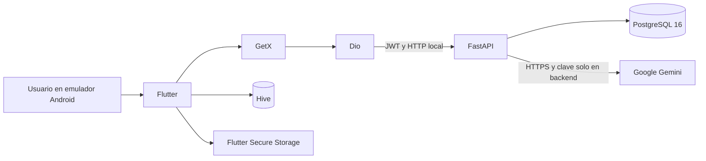

# ITCA TIC Inventario

Proyecto final de la Certificación en Inteligencia Artificial. Es una aplicación
Android para administrar un inventario tecnológico con Flutter, FastAPI y
PostgreSQL. Incluye autenticación JWT, persistencia local de favoritos, un
dashboard, búsqueda y filtros, e integración de Google Gemini a través del
backend.

Repositorio: <https://github.com/hjnarvaez/itca-tic-inventario>

## Alcance implementado

- Registro e inicio de sesión con JWT.
- Listado, creación, consulta, edición y eliminación de equipos.
- Aislamiento del inventario por usuario autenticado.
- Búsqueda por código, nombre o ubicación, sin distinguir mayúsculas ni
  tildes.
- Filtros combinables por estado, categoría y favoritos.
- Favoritos locales persistentes con Hive y separados por usuario.
- Dashboard con totales y distribuciones por estado, categoría y ubicación.
- Asistente de consulta sobre el inventario mediante Gemini.
- Estados de carga, inventario vacío, favoritos vacíos, ausencia de
  coincidencias y errores recuperables.
- Pruebas automatizadas de backend y Flutter y validación continua con GitHub
  Actions.

No se implementaron lectura de códigos QR ni flujos operativos de asignación o
mantenimiento. El estado de un equipo es un atributo del inventario, no un
módulo independiente.

## Arquitectura



Flutter contiene las pantallas, controladores GetX, servicios y repositorios de
acceso HTTP. FastAPI valida el JWT, aplica el aislamiento por usuario y delega
la persistencia en SQLAlchemy/PostgreSQL. Hive conserva exclusivamente los
favoritos locales. La clave de Gemini nunca forma parte del APK.

La descripción completa se encuentra en
[Arquitectura y seguridad](docs/ARQUITECTURA_Y_SEGURIDAD.md).

## Entorno verificado por el repositorio

| Componente | Versión o restricción |
|---|---|
| Python | 3.12; CI usa 3.12.14 |
| `uv` | 0.12.7 en Docker y CI |
| PostgreSQL | 16 Alpine |
| Flutter | 3.47.5 estable en CI |
| Dart | Compatible con `^3.13.4` |
| Java | 17 en CI |
| FastAPI | 0.142.2 en `uv.lock` |
| SQLAlchemy | 2.1.1 en `uv.lock` |

Docker Engine con Docker Compose v2 y un SDK Android compatible también son
necesarios. Las dependencias exactas están bloqueadas en `backend/uv.lock` y
`frontend/pubspec.lock`.

## Inicio rápido para la demostración local

### 1. Obtener el proyecto

```bash
git clone https://github.com/hjnarvaez/itca-tic-inventario.git
cd itca-tic-inventario
```

### 2. Configurar y levantar el backend

```bash
cp backend/.env.example backend/.env
cd backend
docker compose -p itca-inventario up -d --build
docker compose -p itca-inventario ps
```

Antes de iniciar Compose se deben completar en `backend/.env` valores locales
propios para la base de datos y JWT. Para demostrar el asistente también se
requiere una clave de Gemini. No se debe versionar ni compartir ese archivo.

Compose crea PostgreSQL, ejecuta las migraciones mediante el servicio `migrate`
y expone FastAPI solo en `127.0.0.1:8001`.

- Salud: <http://127.0.0.1:8001/health>
- Swagger UI: <http://127.0.0.1:8001/docs>

La creación segura del usuario demostrativo y la carga de los 20 equipos se
explican en la [guía de demostración](docs/GUIA_DEMOSTRACION.md).

### 3. Ejecutar Flutter en el emulador

```bash
cd ../frontend
flutter pub get --enforce-lockfile
flutter devices
flutter run -d <ID_DEL_EMULADOR>
```

En debug, la aplicación usa de forma predeterminada
`http://10.0.2.2:8001`. Android traduce `10.0.2.2` a la máquina anfitriona del
emulador.

## Pruebas

### Backend

Las pruebas recrean el esquema de PostgreSQL. `TEST_DATABASE_URL` debe apuntar
a una base exclusiva, distinta de `DATABASE_URL` y cuyo nombre termine en
`_test`. Nunca se debe usar la base de desarrollo, demostración o producción.

Después de preparar esa base desechable:

```bash
cd backend
uv sync --frozen
uv run ruff check .
uv run pytest --cov=app --cov-report=term-missing --cov-fail-under=80
```

El job backend de [.github/workflows/ci.yml](.github/workflows/ci.yml) crea una
instancia efímera de PostgreSQL 16 y aplica estas protecciones.

### Flutter

```bash
cd frontend
flutter pub get --enforce-lockfile
flutter analyze
flutter test --coverage
flutter build apk --debug
```

Los resultados finales deben registrarse con fecha y commit en la
[matriz de evidencias](docs/EVIDENCIAS_RUBRICA.md). Las cifras de ejecuciones
anteriores son antecedentes y no sustituyen una validación del commit de
entrega.

## APK de demostración

El artefacto autorizado para la entrega académica es:

```text
frontend/build/app/outputs/flutter-apk/app-debug.apk
```

Es un **APK debug de demostración**, previsto para un emulador Android y un
backend local disponible en `10.0.2.2:8001`. No es una versión release, no debe
presentarse como lista para producción y no funcionará en un teléfono físico sin
configurar una dirección de backend accesible.

Profile y release bloquean HTTP y exigen una URL HTTPS explícita. Una
distribución release también requiere una firma privada configurada localmente;
esas credenciales no forman parte del repositorio ni de esta entrega.

## Documentación

- [Guía de demostración](docs/GUIA_DEMOSTRACION.md)
- [Arquitectura y seguridad](docs/ARQUITECTURA_Y_SEGURIDAD.md)
- [Matriz de evidencias de la rúbrica](docs/EVIDENCIAS_RUBRICA.md)
- [Convenciones para capturas y resultados](docs/evidencias/README.md)

## Limitaciones conocidas

- El despliegue documentado es local y usa HTTP exclusivamente en debug.
- FastAPI escucha en la interfaz local del anfitrión; no es un servicio público.
- La demostración de Gemini necesita Internet, una clave válida y un modelo
  disponible para esa clave.
- No se configuraron proxy inverso, TLS público, supervisión ni estrategia de
  respaldo para producción.
- El backend conserva módulos heredados de gastos y MCP que no utiliza la
  aplicación Flutter de inventario.
- No existen artefactos Spec-Kit/SDD en el repositorio. No se consideran un
  requisito hasta contar con una consigna oficial verificable.

Los registros demostrativos son ficticios y deben mantenerse libres de datos
personales reales.

---

Proyecto académico desarrollado para la Certificación en Inteligencia
Artificial.
