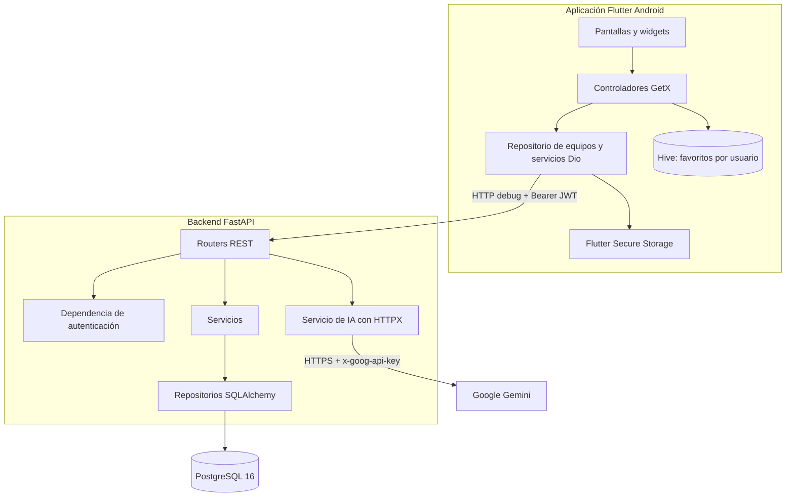
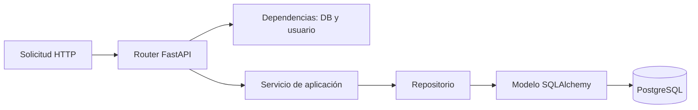
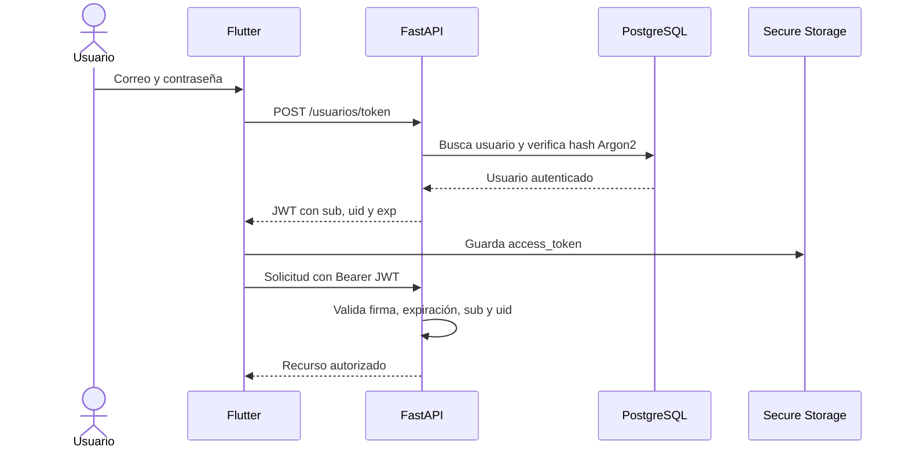
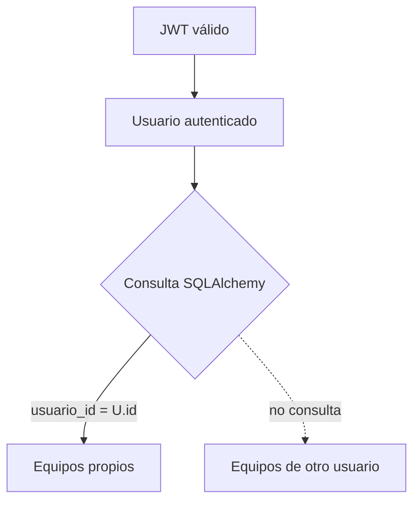
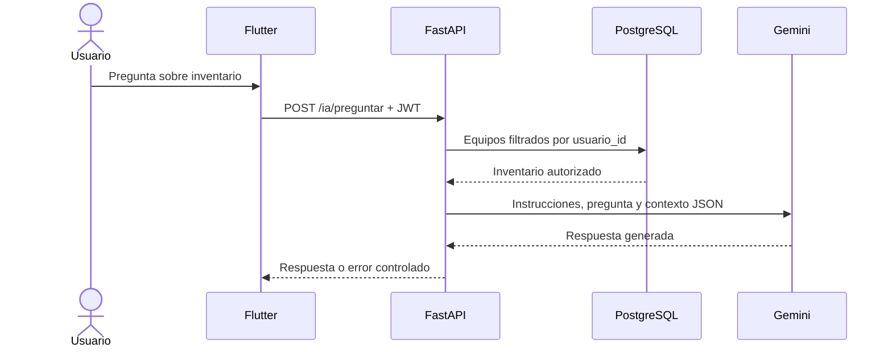

# Arquitectura y seguridad

Este documento describe la implementación real de ITCA TIC Inventario en el
commit de referencia `d9982c5`. No describe una arquitectura futura ni convierte
los módulos heredados en funcionalidades de la aplicación Flutter.

## 1. Vista general



En la demostración, Flutter se ejecuta en un emulador y usa
`http://10.0.2.2:8001`. FastAPI y PostgreSQL se ejecutan en Docker en la
computadora anfitriona.

## 2. Capas del frontend

### Presentación

Las pantallas de `frontend/lib/screens/` implementan:

- Autenticación.
- Listado y formularios CRUD.
- Búsqueda y filtros.
- Dashboard.
- Asistente de IA.
- Estados de carga, vacío, error y reintento.

`HomeScreen` mantiene el controlador del inventario durante su ciclo de vida y
abre el dashboard, los formularios y el asistente mediante navegación de
Flutter.

### Estado con GetX

Los controladores de `frontend/lib/controllers/` contienen el estado reactivo:

- `AuthController`: verificación de sesión, login, logout y mensajes de error.
- `EquiposController`: equipos, favoritos, filtros, carga, guardado y errores.
- `IaController`: pregunta, respuesta, carga y errores del asistente.

Las pantallas observan estos valores mediante `Obx`. Los cambios de filtros son
locales y no generan una consulta HTTP por cada selección.

### Dominio y filtrado local

- `Equipo` representa los datos recibidos del backend.
- `FiltroInventario` combina texto, estado, categoría y favoritos.
- `ResumenInventario` calcula las estadísticas del dashboard a partir de los
  equipos ya obtenidos para el usuario.

Las categorías se derivan del inventario recibido. La búsqueda normaliza
mayúsculas y caracteres acentuados.

### Acceso remoto

`EquiposRepository`, `AuthService` e `IaService` utilizan Dio. Las operaciones
protegidas obtienen el JWT desde Flutter Secure Storage y lo envían mediante el
encabezado `Authorization: Bearer`.

## 3. Capas del backend



- `app/routers/` define el contrato HTTP y las dependencias de autenticación.
- `app/services/` implementa las reglas de la aplicación y traduce errores del
  proveedor de IA.
- `app/repositories/` concentra consultas y escritura mediante SQLAlchemy.
- `app/models/` contiene las entidades persistidas.
- `app/schemas/` valida entradas y respuestas con Pydantic.
- `app/database.py` configura el motor y las sesiones.

Alembic administra el esquema. En el Compose local, el contenedor `migrate`
termina antes de que inicie el servicio `backend`.

## 4. Autenticación JWT



Las contraseñas se almacenan mediante Argon2. El JWT usa HS256 y una
`SECRET_KEY` externa al repositorio. La validación exige que el correo (`sub`) y
el identificador (`uid`) sigan correspondiendo al mismo usuario.

El JWT se guarda en Flutter Secure Storage, no en Hive. No debe aparecer en
logs, capturas o documentos.

## 5. Aislamiento de datos

Cada equipo tiene una clave foránea `usuario_id`. Los endpoints de equipos
obtienen al usuario mediante `get_current_user`; el cliente no elige ese ID.

Las consultas del repositorio incluyen simultáneamente el identificador del
equipo y `usuario_id`. El código de equipo es único dentro del inventario de un
usuario, no globalmente.



El asistente aplica el mismo aislamiento: carga los equipos del usuario actual
antes de construir el contexto enviado a Gemini.

## 6. Persistencia local con Hive

Los favoritos no se almacenan en PostgreSQL. `FavoritosService` primero consulta
`/usuarios/me`, obtiene el ID autenticado y abre una caja Hive con el nombre:

```text
favoritos_usuario_<ID>
```

Solo se guardan códigos de equipos. Este diseño evita mezclar favoritos entre
usuarios que utilizan la misma instalación. La existencia de la caja no concede
acceso a datos remotos: el inventario sigue protegido por JWT en FastAPI.

## 7. Integración de Gemini



- `GEMINI_API_KEY` se carga mediante la configuración del backend.
- La solicitud al proveedor usa HTTPS y el encabezado `x-goog-api-key`.
- Flutter no conoce, almacena ni transmite la clave de Gemini.
- El contexto solo contiene código, nombre, categoría, estado y ubicación.
- El prompt indica que el modelo no debe inventar datos ni ejecutar
  instrucciones presentes en el inventario.
- Preguntas y respuestas vacías, fallos HTTP y falta de configuración se
  traducen a errores controlados.
- El asistente es de consulta; no crea, modifica ni elimina equipos.

Los datos enviados a Gemini salen del entorno local. Por ello, los registros de
demostración deben ser ficticios y no deben contener información personal o
confidencial.

## 8. Seguridad de red Android

La configuración parte de una política segura:

- `main`: `usesCleartextTraffic=false` y configuración de red con cleartext
  deshabilitado.
- `debug`: superpone una política que permite HTTP para desarrollo y admite el
  valor predeterminado `http://10.0.2.2:8001`.
- `profile` y `release`: heredan la prohibición de HTTP.

`ApiConfig` aplica una segunda validación:

- Debug acepta una URL HTTP o HTTPS explícita y usa el emulador como valor
  predeterminado.
- Profile y release exigen una URL HTTPS explícita.
- Se rechazan URLs relativas, esquemas distintos de HTTP/HTTPS, credenciales
  embebidas, fragmentos y puertos inválidos.

No se agregaron certificados propios, autoridades personalizadas ni mecanismos
que relajen la validación TLS.

## 9. Firma Android

Debug usa la firma de desarrollo administrada por las herramientas Android.
Release nunca utiliza automáticamente esa firma.

Para empaquetar release se requiere un `frontend/android/key.properties` local
completo y un keystore existente. Ambos están excluidos de Git. Si falta la
configuración, Gradle termina con un mensaje explícito.

La entrega acordada no genera ni distribuye un release: utiliza el APK debug
con el backend local.

## 10. Manejo de errores y estados

El frontend diferencia, entre otros:

- Verificación y carga.
- Inventario vacío.
- Favoritos vacíos.
- Búsqueda sin coincidencias.
- Sesión expirada.
- Código duplicado.
- Equipo inexistente.
- Datos inválidos.
- Fallo de conexión.
- Indisponibilidad del proveedor de IA.

FastAPI dispone de validación Pydantic, errores HTTP de dominio y un manejador
general que devuelve un mensaje genérico para errores no controlados.

## 11. Componentes activos y heredados

### Utilizados por Flutter

- Routers de usuarios, equipos, salud e IA.
- Modelos de usuario y equipo.
- Servicios y repositorios de usuarios y equipos.
- Servicio de Gemini.
- PostgreSQL, Alembic y autenticación JWT.

### Conservados pero fuera del alcance de Flutter

- Router, modelo, servicios, repositorios y pruebas de gastos.
- Servidor y herramientas MCP relacionados con gastos.
- Metadatos históricos de gastos/Spec-Driven Development en `pyproject.toml`.

FastAPI monta actualmente los routers heredados y `/mcp`, por lo que aparecen en
la aplicación aunque Flutter no los consume. No deben presentarse como parte de
ITCA TIC Inventario ni como evidencia de los requisitos funcionales de esta
entrega.

## 12. Limitaciones del despliegue local

- FastAPI se publica en `127.0.0.1:8001`; no es accesible desde Internet.
- `10.0.2.2` es propio del emulador Android y no resuelve el acceso desde un
  teléfono físico.
- HTTP se acepta solamente en debug.
- No se configuraron dominio público, certificado TLS, proxy inverso, rate
  limiting externo, monitoreo ni alertas.
- El volumen PostgreSQL local no constituye una estrategia formal de respaldo.
- Gemini depende de un servicio externo, conectividad y disponibilidad del
  modelo configurado.
- Los logs de autenticación pueden incluir el correo del usuario; para la
  demostración deben emplearse identidades ficticias y evitarse capturas de
  logs innecesarias.

Estas limitaciones son aceptables para el escenario académico acordado, pero no
para una distribución productiva.
